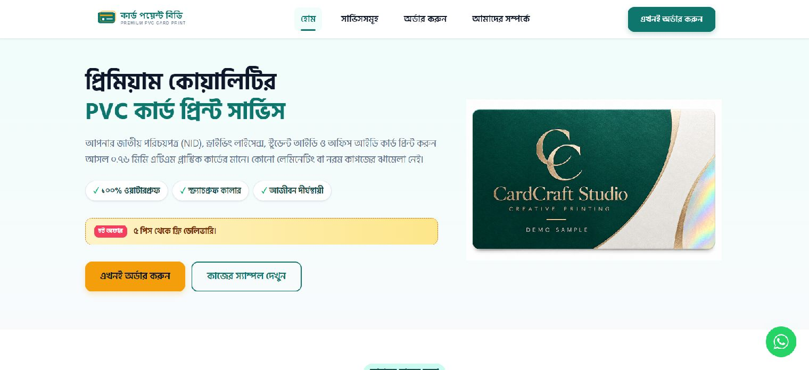
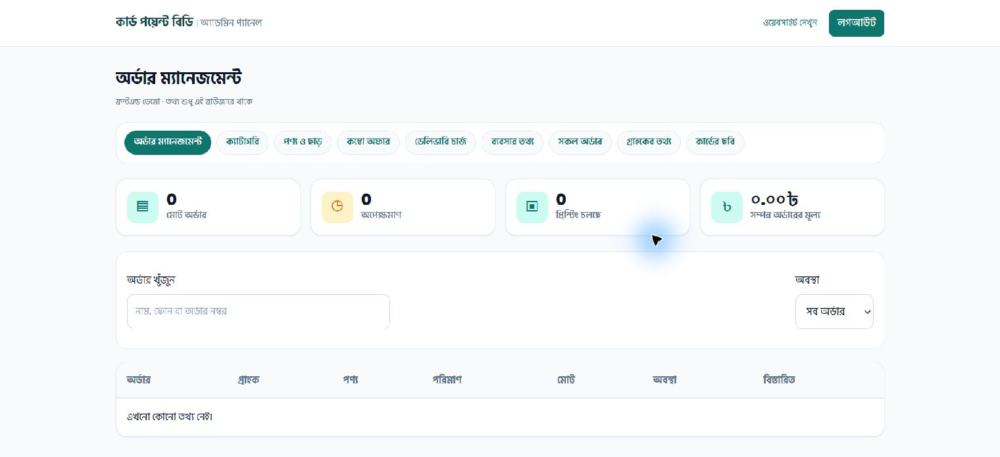

# CardCraft Studio

A Bangla card-printing website with a storefront, front/back card previews, order form, and admin demo interface.

## Run the demo

Open `index.html` in your browser, or open this folder in VS Code and use Live Server. No install or build step is needed. Use the same browser and origin for the storefront, orders, and admin pages.

| Page | Interface |
| --- | --- |
| `index.html` | Homepage, product catalog, search, and flipping card previews |
| `order.html` | Quantities, artwork selection, delivery, and demo order submission |
| `admin.html` | Product images, prices, orders, customers, and business settings |
| `about.html` | About the business |
| `privacy.html` | Privacy information |

On the admin page, select **Enter admin preview**. This is a browser-only demo: products, orders, artwork, and settings are stored in localStorage. It has no protected admin login, shared database, payment processing, or live order service. Use fictional customer details. Browser storage is separate for each browser/origin; clearing site data resets it.

## UI / UX screenshots

Actual screenshots of the running website interfaces. The admin screenshot shows the clean demo dashboard with no customer data.

### Homepage — `index.html`

### Admin panel — `admin.html`

### Demo card assets

The website's product previews still use the included fictional, AI-generated front/back card assets in `images/`. Identity, driving, vaccine, and student samples are marked **DEMO / নমুনা** and **NOT VALID**; they are not issued documents. Replace them through the admin product editor.

## Repository scope

This repository includes the current static frontend and the assets it uses. Local databases, orders, account data, backups, editor settings, unused earlier backend code, and unused images are excluded. Google Fonts loads externally when available; local fallback fonts remain usable offline.

Replace sample contact details, business information, and policy copy before using this as a live business website. Real authentication, order storage, secure artwork handling, and payment services require backend integration.
